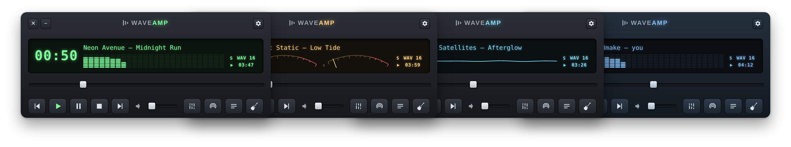
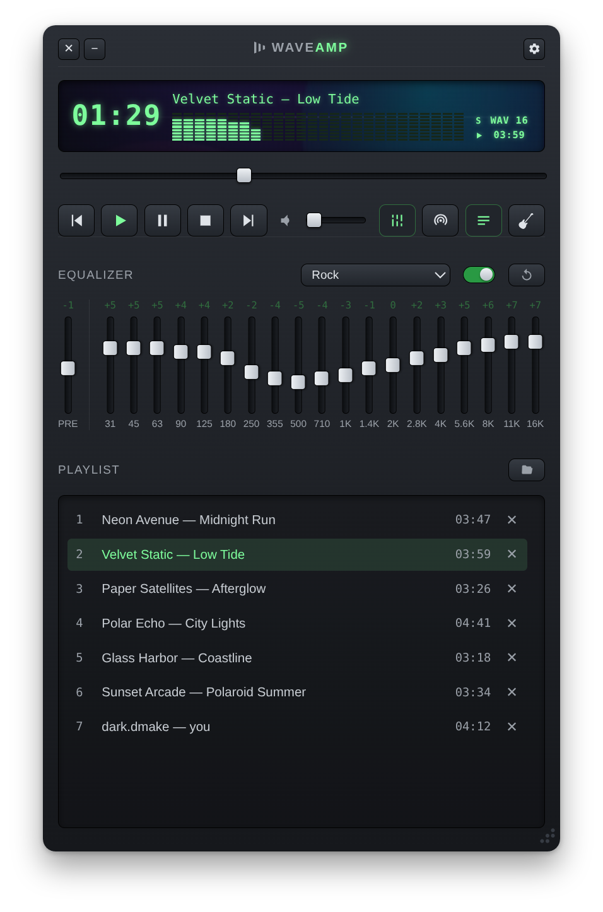
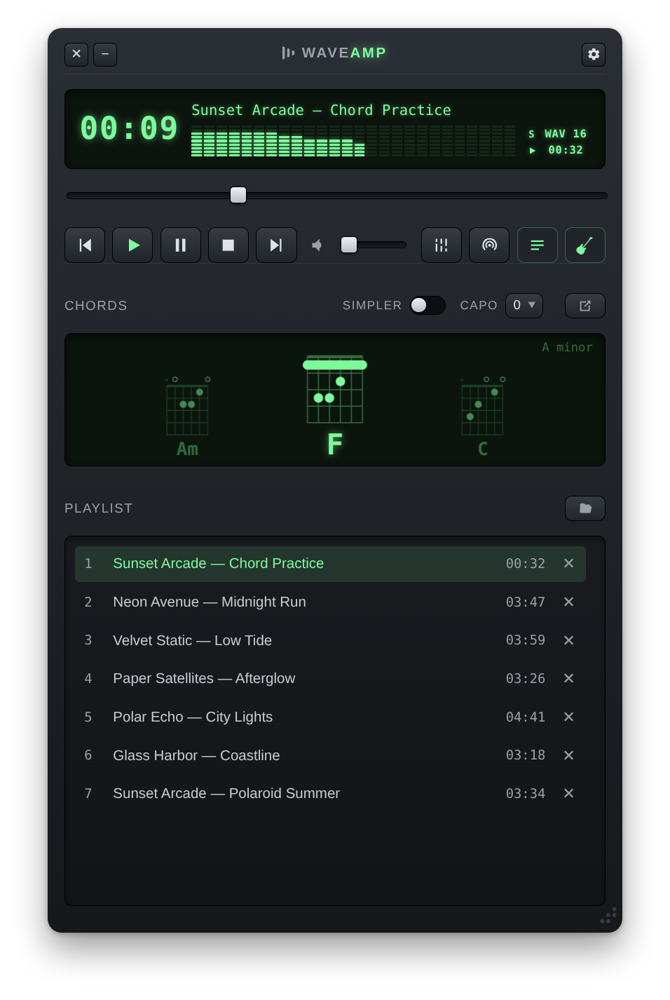
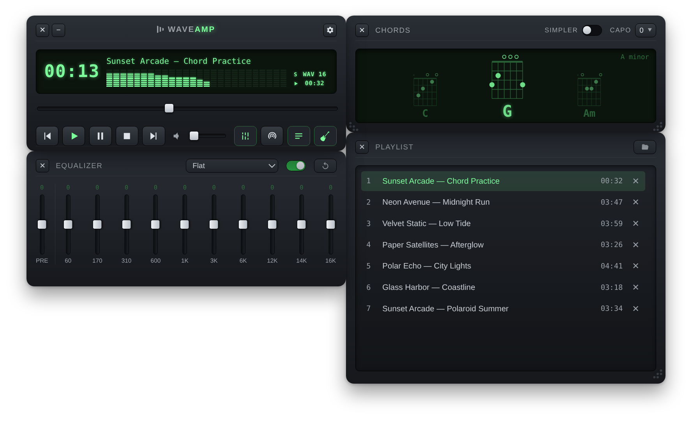
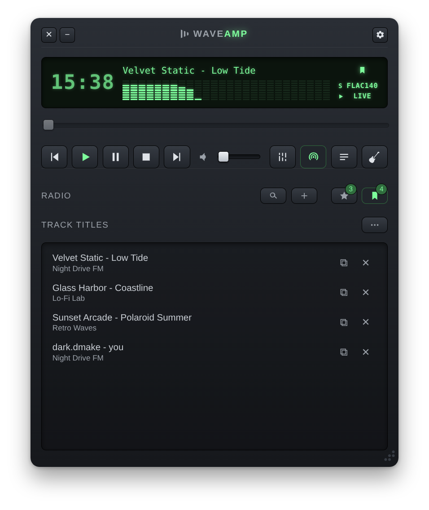
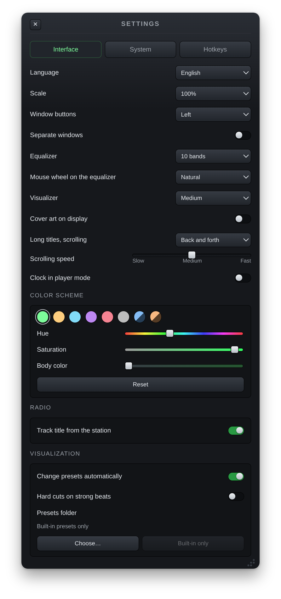
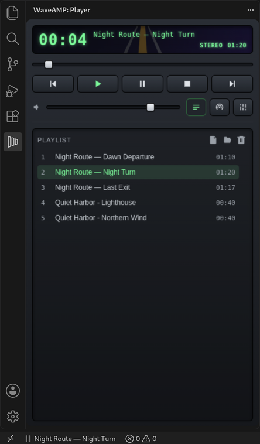

# WaveAMP

[English](README.md) | **Русский**

Десктопный аудиоплеер с интернет-радио в стиле классического Winamp: тёмный
корпус, светящийся LCD-дисплей и настоящий эквалайзер на 10 или 19 полос.
Работает на macOS, Windows и Linux.

**Есть и для VS Code:** WaveAMP в боковой панели редактора —
[waveamp-vscode](https://github.com/darkdkl/waveamp-vscode).

<p align="center">
  
</p>

<p align="center">
  
  
</p>

<p align="center">
  
</p>

<p align="center">
  
  
</p>

## Возможности

- **Плеер** — воспроизведение, пауза, стоп, перемотка и громкость; локальные
  файлы добавляются кнопкой или перетаскиванием
- **Плейлист** — растягиваемый, с автопереходом на следующий трек
- **Теги** — «Исполнитель — Название» и длительность из тегов файла (ID3,
  FLAC/Vorbis, MP4 и др.); старые русские теги в cp1251 и неверно
  прочитанные UTF-8 исправляются. Длинные названия прокручиваются на
  дисплее — туда-обратно, по кругу или один раз, с выбранной скоростью
- **Обложки** — обложка альбома (вшитая в файл или `cover.jpg` / `folder.jpg`
  рядом с ним) или логотип радиостанции приглушённо видны на фоне дисплея и в
  «Сейчас играет» системы; отключается в настройках
- **Эквалайзер** — 10 полос (60 Гц–16 кГц) или 19 более узких полос
  (31 Гц–16 кГц), которые точно следуют ползункам, и преамп на реальной
  обработке звука через Web Audio API. 18 пресетов на основе классических
  пресетов Winamp с автоматическим запасом по преампу и пользовательский
  пресет, который запоминает ваши собственные настройки
- **Визуализатор** — режимы в LCD, переключаются кликом: LED-спектр,
  стрелочные индикаторы L/R и осциллограф. Плавный или пиковый отклик.
  Показывает реальный сигнал и не зависит от громкости
- **Пресеты визуализации** — четвёртый режим раскрывает дисплей в большую
  картинку на [projectM](https://github.com/projectM-visualizer/projectm),
  совместимую с пресетами MilkDrop (`.milk`): собственные встроенные пресеты
  WaveAMP и любая папка с файлами `.milk`, автосмена, полный экран
- **Интернет-радио** — поиск станций через
  [Radio Browser API](https://www.radio-browser.info/) с фильтрами по стране,
  региону и жанру, избранное. Станцию можно добавить и вручную — по ссылке на
  поток или на плейлист .pls/.m3u. Эквалайзер и визуализатор работают и для радио
- **Сохранённые названия треков** — дисплей показывает трек, который играет на
  станции; понравившиеся названия можно сохранить в список и скопировать
- **Часы** на дисплее для радио, а по желанию — попеременно со временем трека
  при воспроизведении
- **Цветовая схема** — готовые схемы и ползунки оттенка, насыщенности и цвета
  корпуса
- **Горячие клавиши** — настраиваемые сочетания, работают на любой раскладке;
  глобальные клавиши по желанию
- **Медиаклавиши и системный Now Playing** (Пункт управления macOS, медиапанель
  Windows)
- **Иконка в трее** и сворачивание в трей по желанию
- **Аккорды играющей песни** — по кнопке разбирает трек и по ходу
  воспроизведения показывает предыдущий, текущий и следующий аккорд с
  гитарными схемами, с каподастром и упрощённым режимом; работает и для
  треков CUE-альбомов. Аккорды можно вынести в отдельное окно и растянуть
  почти на весь экран; всё считается на вашем компьютере. На радио аккорды
  распознаются на лету, пока играет станция: они появляются примерно на
  секунду позже и менее точны, чем у файлов, — распознаванию нельзя заглянуть
  вперёд, и мешают речь и реклама
- **Отдельные окна** — эквалайзер, аккорды и плейлист/радио могут жить в своих
  окнах, которые прилипают друг к другу и к краям экрана, двигаются вместе с
  плеером и запоминают, где стояли (на Linux с Wayland плеер тогда работает
  через XWayland)
- **Перемещение плеера** — за любое пустое место, а не только за заголовок
- **Прокси HTTP / SOCKS5** для радио
- **Проверка обновлений** — сообщает о новой версии и даёт ссылку на страницу
  загрузки
- **Русский и английский интерфейс**, масштаб интерфейса; плейлист,
  эквалайзер, избранное и расположение панелей восстанавливаются при запуске

## WaveAMP для VS Code

Тот же плеер — внешний вид, плейлист, эквалайзер и интернет-радио — есть и в
боковой панели VS Code. Скачайте `.vsix` со страницы
[релизов waveamp-vscode](https://github.com/darkdkl/waveamp-vscode/releases/latest)
и установите командой **Extensions: Install from VSIX…**; всё остальное — в
репозитории [waveamp-vscode](https://github.com/darkdkl/waveamp-vscode).

<p align="center">
  
</p>

## Скачать

Установщики лежат в [Releases](https://github.com/darkdkl/waveamp/releases/latest) —
новая версия собирается и публикуется автоматически при каждом обновлении `main`.

| Система | Файл |
|---|---|
| macOS 13+ (Apple Silicon) | `WaveAMP-<версия>-arm64.dmg` |
| Windows 10/11 (x64) | `WaveAMP-Setup-<версия>.exe` |
| Linux (x64) | `WaveAMP-<версия>.AppImage` |
| Linux (ARM64) | `WaveAMP-<версия>-arm64.AppImage` |

Сборки не подписаны сертификатом разработчика, поэтому при первом запуске
система предупредит о неизвестном источнике:

- **macOS**: перетащите WaveAMP в «Программы», затем снимите с него карантин,
  который macOS ставит на скачанные файлы, — выполните в Терминале:

  ```bash
  xattr -cr /Applications/WaveAMP.app
  ```

  Без этого macOS может сообщить, что приложение «повреждено» или его
  «не удалось проверить». Другой способ — попытаться открыть приложение,
  затем Системные настройки → Конфиденциальность и безопасность →
  «Всё равно открыть».
- **Windows**: «Подробнее» → «Выполнить в любом случае» в окне SmartScreen
- **Linux**: `chmod +x WaveAMP-*.AppImage` перед запуском. Для AppImage нужен
  FUSE 2: если приложение не запускается и ругается на FUSE, установите его —
  `sudo apt install libfuse2t64` в Debian 13 и Ubuntu 24.04+ (`libfuse2` в
  более старых версиях) — или запустите с `--appimage-extract-and-run`.

## Сборка из исходников

TypeScript без UI-фреймворков, сборка — [electron-vite](https://electron-vite.org/)
(Vite), тесты — Vitest. Нужен Node.js 20.19+.

```bash
npm install
npm run dev
```

`npm run dev` запускает приложение с горячей перезагрузкой; `npm start` — продакшн-сборку.

Проверки:

```bash
npm run typecheck
npm test
```

Установщики:

```bash
npm run build:mac
npm run build:linux
npm run build:win
```

## Обратная связь

Сообщения об ошибках и идеи — в [Issues](https://github.com/darkdkl/waveamp/issues),
см. [CONTRIBUTING.md](CONTRIBUTING.md). Об уязвимостях: [SECURITY.md](SECURITY.md).

## Используемые библиотеки

- [Electron](https://www.electronjs.org/) — десктопная обвязка (MIT; Chromium и
  его компоненты — под своими лицензиями)
- [music-metadata](https://github.com/Borewit/music-metadata) — чтение тегов
  аудиофайлов (MIT)
- [projectM](https://github.com/projectM-visualizer/projectm) — движок пресетов
  визуализации, собранный в WebAssembly (LGPL-2.1)
- [@wasm-audio-decoders/flac](https://github.com/eshaz/wasm-audio-decoders) —
  декодирование FLAC для распознавания аккордов, на основе
  [libFLAC](https://github.com/xiph/flac) (MIT; libFLAC — BSD-3-Clause),
  вместе с [codec-parser](https://github.com/eshaz/codec-parser) (LGPL-3.0)

Полный список со всеми зависимостями и текстами лицензий собирается в
`THIRD_PARTY_LICENSES.txt` перед каждым запуском и сборкой (`npm run licenses`),
кладётся рядом с приложением и открывается из Настройки → Системные →
О программе.

## Лицензия

Copyright © 2026 Dark.Dmake

WaveAMP — свободная программа: её можно распространять и изменять на условиях
[GNU General Public License](LICENSE) версии 3 либо (по вашему выбору) любой
более поздней версии.

Эта программа распространяется в надежде, что она будет полезной, но БЕЗ
КАКИХ-ЛИБО ГАРАНТИЙ, даже без подразумеваемых гарантий ТОВАРНОГО СОСТОЯНИЯ или
ПРИГОДНОСТИ ДЛЯ КОНКРЕТНОЙ ЦЕЛИ. Подробности — в GNU General Public License.

## Товарные знаки

Winamp — товарный знак соответствующего правообладателя. WaveAMP —
независимый проект, он не связан с правообладателем Winamp и не одобрен им;
упоминания Winamp здесь лишь описывают стиль плеера и происхождение
пресетов эквалайзера. MilkDrop упоминается как название формата пресетов
визуализации (`.milk`), который поддерживает projectM, и чтобы назвать его
автора.

## Благодарности

Интернет-радио в WaveAMP работает на [Radio Browser](https://www.radio-browser.info/) —
бесплатной базе радиостанций, которую, как Википедию, пополняет сообщество; её
данные — общественное достояние (public domain), а серверы автор содержит на
пожертвования. Спасибо за то, что это существует и остаётся открытым.

Пресеты визуализации работают на [projectM](https://github.com/projectM-visualizer/projectm) —
открытой реализации MilkDrop, которую его команда развивает уже много лет.
Спасибо разработчикам projectM и Райану Гайссу (Ryan Geiss) за оригинальный
MilkDrop. Тысячи других пресетов — в коллекции
[«Cream of the Crop»](https://github.com/projectM-visualizer/presets-cream-of-the-crop),
которую составил ISOSCELES: скачайте её и укажите папку в Настройки →
Интерфейс → Визуализация.
